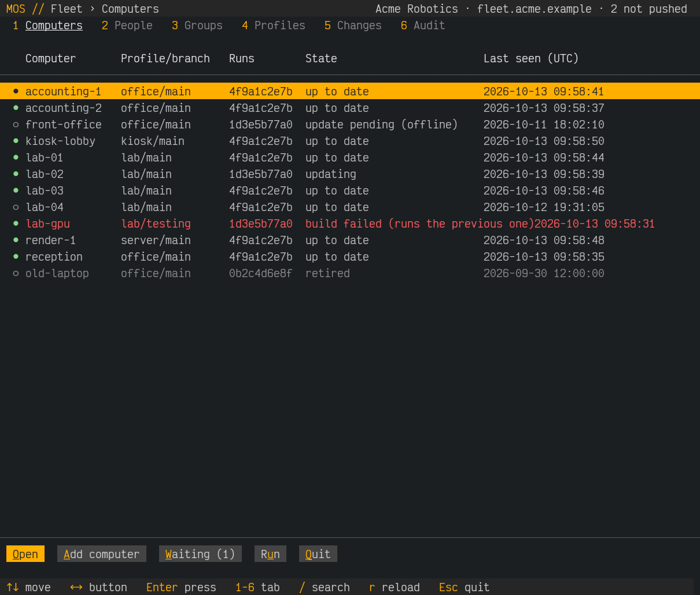
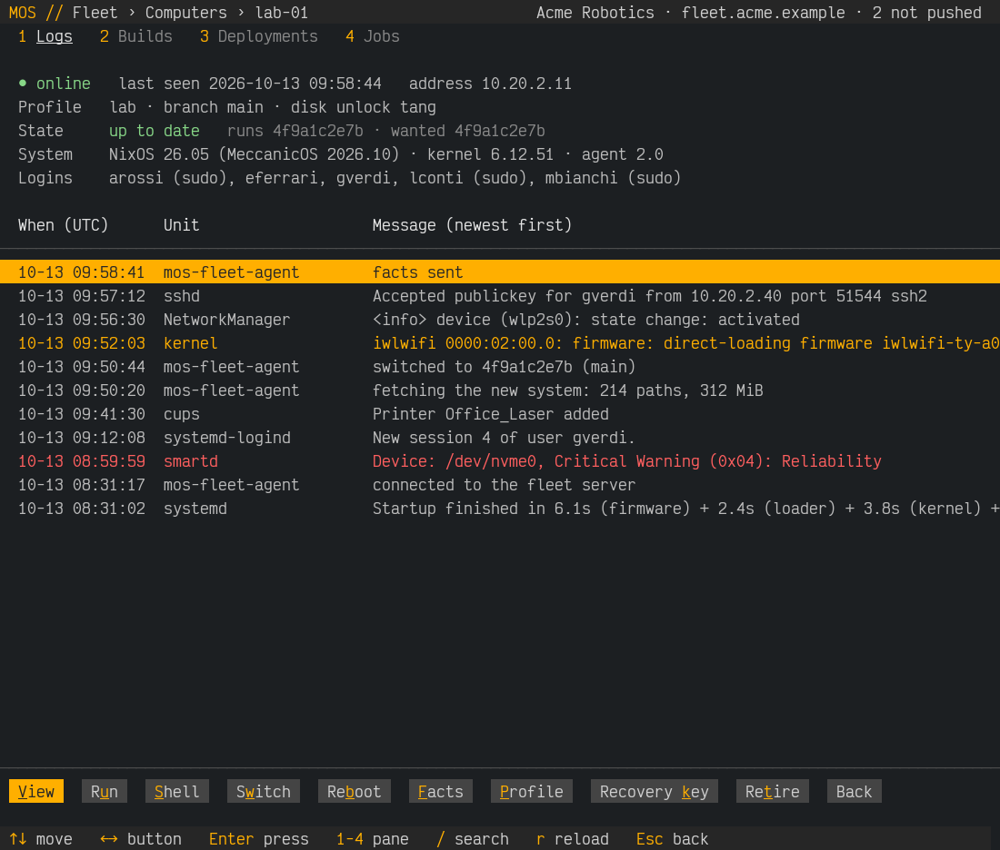
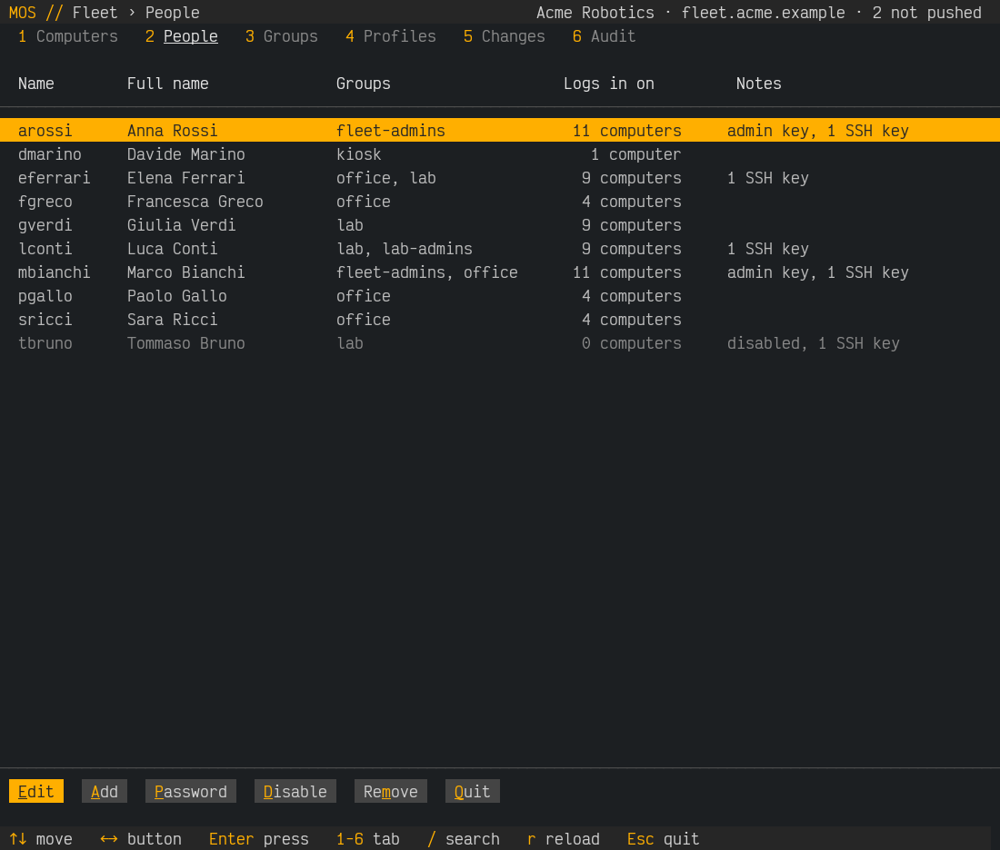
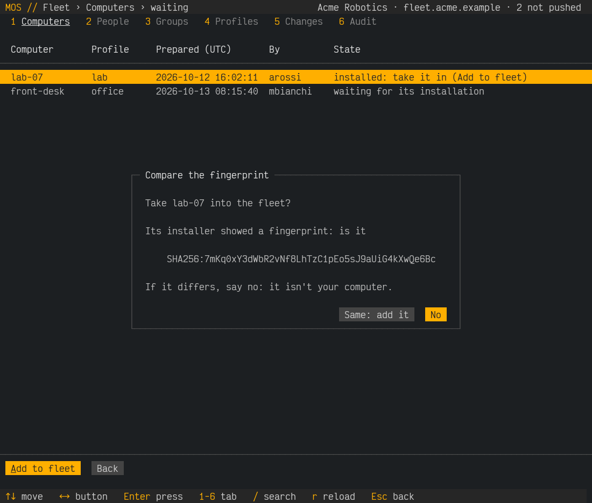
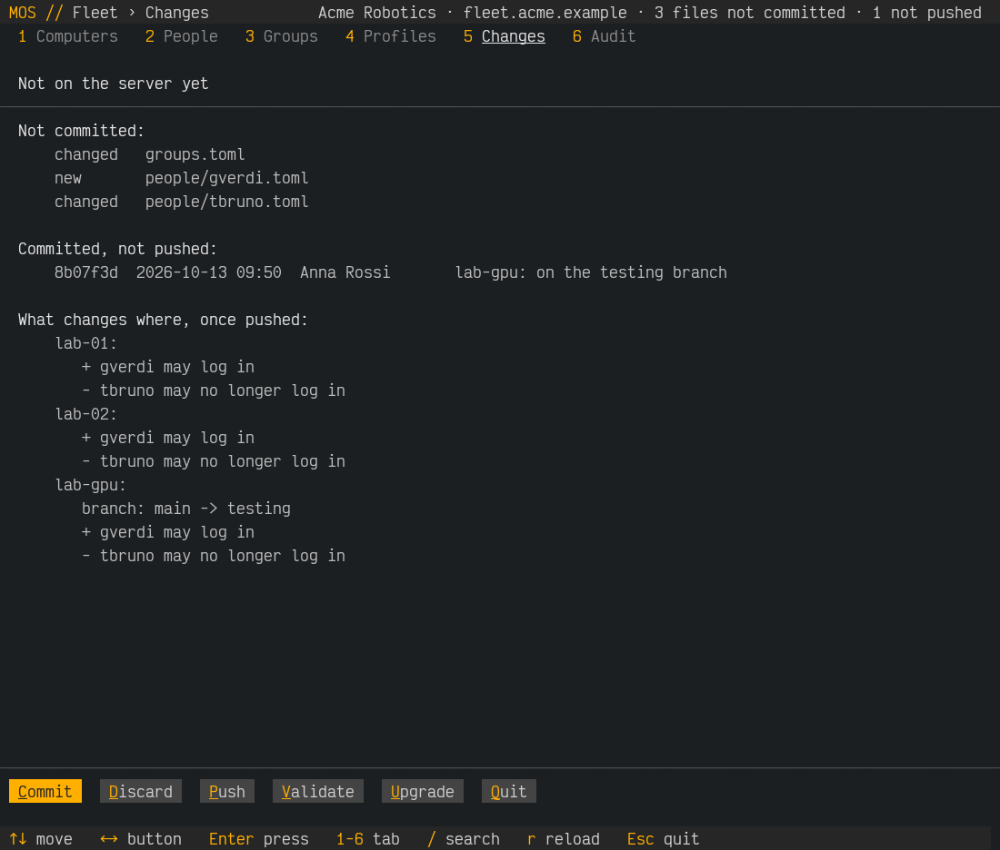

# `mos-fleet tui`: the fleet, full screen

> The fleet itself: [DESIGN.md](DESIGN.md), [ADMIN-GUIDE.md](ADMIN-GUIDE.md).
> (A web UI was designed first, in py4web and Vue, and set aside for this:
> nothing to install, nothing listening, and the same look as the other mos
> tools. Its design is in the git history, commit ea87285.)

```
mos-fleet                    in a terminal, with no command (in or with ~/fleet)
mos-fleet tui [--repo DIR]   the same
mos-fleet tui --demo         made-up data (Acme Robotics): nothing is read or changed
```



## What it is

A front end to `mos-fleet`, in the look every MeccanicOS full-screen tool
shares (`scripts/lib/mos_tui.py`): the title bar, the keys at the bottom,
and what Enter acts on in amber.

- **It runs where you run `mos-fleet`**, as you: your clone of the fleet
  repository, your SSH key, your admin key. Nothing new on the server and
  nothing listening: it reads the repository, and asks the server over the
  same SSH forced commands as the command line (with `--json`).
- **Every change is the command you would type.** Add, Edit and Retire run
  `mos-fleet person add … --no-commit`, `mos-fleet host retire … --no-commit`
  and so on: the files change and the whole repository is checked (an edit
  that would make it invalid is put back), but **nothing is committed**.
  Make several, then **Commit** (tab 5) commits them all at once with your
  message (`mos-fleet commit -m …`), or **Discard** puts the repository back
  to its last commit. The title bar counts the files not committed and the
  commits not pushed.
- **Only commits reach the server.** Push (`mos-fleet push`) refuses while
  anything is not committed, so what it checks (the files, and every
  computer evaluated with Nix) is exactly what it sends; the server builds
  only what it received (`fleet.git`), and checks every push again
  (pre-receive). Password, Run, Switch, Reboot, Facts and Recovery key don't
  touch the repository: they go to the server at once.
- **Shell** leaves the full screen for `mos-fleet shell NAME` (SSH end to
  end, through the server) and comes back when you exit; **Edit** on a
  profile opens your editor (`$VISUAL`, `$EDITOR`, else jed) on
  `profiles/NAME.nix`, then checks it (and puts it back if it isn't valid).

## Tabs

| Tab | Shows | Buttons |
|---|---|---|
| **1 Computers** | every computer: online (●), profile/branch, the revision it runs, its state, last seen; failed builds in red | Open, Add computer (`host prepare`), Waiting (computers that introduced themselves: Add to fleet, after comparing the fingerprint), Run (on a profile's computers) |
| a computer (Open) | address, profile, branch, unlock, state, the revision it runs and should run, OS, kernel, who may log in (with sudo or not); panes **1 Logs, 2 Builds, 3 Deployments, 4 Jobs** (View: a build's log, a deployment's or job's output) | View, Run, Shell, Switch, Reboot, Facts, Profile (`host set`), Recovery key (`recover`: asked again, audited), Retire, Back |
| **2 People** | user name, full name, groups, on how many computers they may log in, admin key, SSH keys, disabled | Edit, Add, Password (only the hash leaves), Disable/Enable, Remove |
| **3 Groups** | gid, sudo, the profiles its members may log in on, members | Edit, Members, Add, Remove |
| **4 Profiles** | each one's computers and groups | Edit (your editor), Add, Remove |
| **5 Changes** | the files not committed, the commits not pushed, and what all of it changes on which computer (`mos-fleet diff --worktree`) | Commit (one message for all), Discard, Push (validate with Nix first; refused until everything is committed), Validate, Upgrade (MeccanicOS; testing branch first) |
| **6 Audit** | the server's audit: pushes, jobs, passwords, recovery keys, enrollments | — |

Keys: ↑↓ PgUp PgDn move; ←→ (Tab) choose a button, Enter presses it (the
first button acts on the chosen line), its underlined letter too; 1–6 tabs
(1–4: a computer's panes); `/` searches the list; `r` reloads; Esc goes back
(or quits).









## Code and tests

- `scripts/mos_fleet/tui.py`: `Live` (the repository and the server),
  `Demo` (the made-up fleet), `App` (the screens), `form` and `pager`.
- The server's `logs`, `builds`, `deployments`, `jobs`, `audit` and
  `enroll-list` answer `--json` for it (as `status`, `job` did).
- The fleet VM test runs `mos-fleet tui --check`, which prints every tab and
  every pane of every computer from the real server instead of drawing them,
  and fails if the server refused anything.
